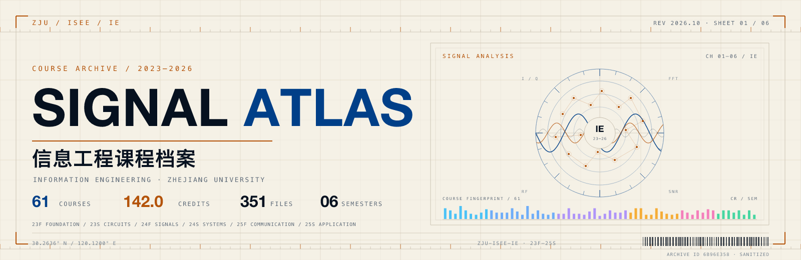
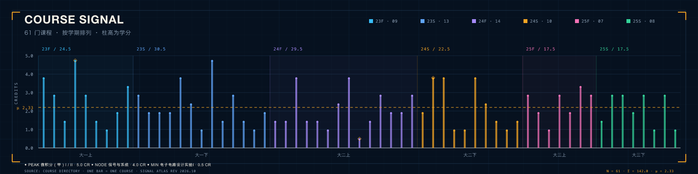
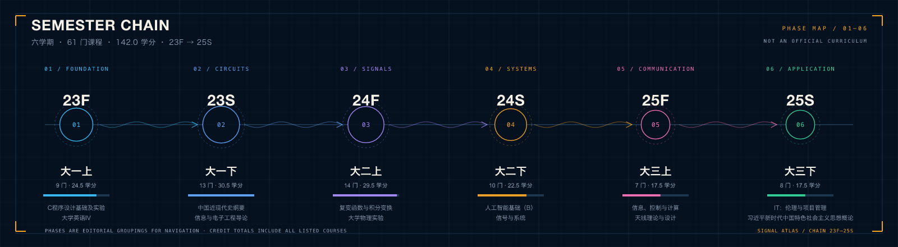
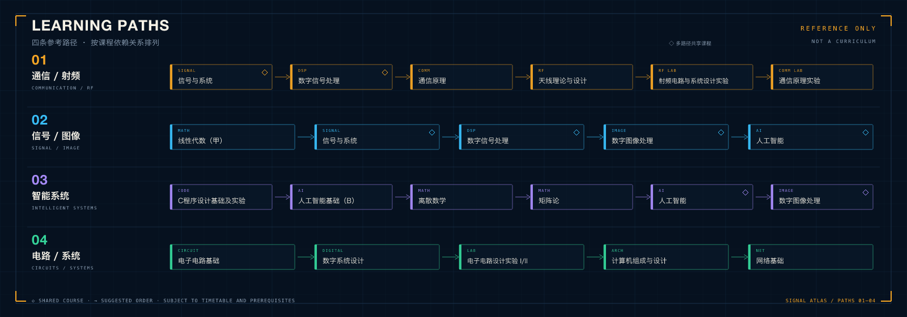

<p align="center">
  <picture>
    <source media="(prefers-color-scheme: dark)" srcset="./assets/hero-dark.png">
    <source media="(prefers-color-scheme: light)" srcset="./assets/hero-light.png">
    
  </picture>
</p>

<p align="center">
  <b>浙江大学 · 信息与电子工程学院 · 信息工程</b><br>
  <sub>2023 – 2026　·　六个学期　·　61 门课程　·　351 份资料</sub><br>
  <sub>把三年课程档案做成一张可检索的信号图谱</sub>
</p>

<p align="center">
  
  
  
  
  
  
</p>

<p align="center">
  <a href="#仓库速览"><kbd>01</kbd> 速览</a>　·　<a href="#从这里开始"><kbd>02</kbd> 入口</a>　·　<a href="#课程图谱"><kbd>03</kbd> 图谱</a><br>
  <a href="#学习路径"><kbd>04</kbd> 路径</a>　·　<a href="#使用指南"><kbd>05</kbd> 指南</a>　·　<a href="#声明"><kbd>06</kbd> 声明</a>
</p>

<p align="center">
  <sub><samp>30.2636° N / 120.1200° E　·　ARCHIVE 23F—25S　·　REV 2026.10　·　SANITIZED</samp></sub>
</p>

---

## 仓库速览

> 六学期、61 门课程、142.0 学分。每门课都有独立目录；61 份课程记录中，60 篇为详细体验，`大学物理实验` 为成绩记录。

<table width="100%">
<thead>
<tr><th align="left">学期</th><th align="left">课程档案</th></tr>
</thead>
<tbody>
<tr><td><b>大一上</b><br><sub>23F</sub></td><td><b>9 门 · 24.5 学分 · 9 份记录</b><br>微积分（甲）I · 线性代数（甲）</td></tr>
<tr><td><b>大一下</b><br><sub>23S</sub></td><td><b>13 门 · 30.5 学分 · 13 份记录</b><br>微积分（甲）II · 大学物理（甲）I</td></tr>
<tr><td><b>大二上</b><br><sub>24F</sub></td><td><b>14 门 · 29.5 学分 · 14 份记录</b><br>电子电路基础 · 概率论与数理统计</td></tr>
<tr><td><b>大二下</b><br><sub>24S</sub></td><td><b>10 门 · 22.5 学分 · 10 份记录</b><br>信号与系统 · 电磁场与电磁波</td></tr>
<tr><td><b>大三上</b><br><sub>25F</sub></td><td><b>7 门 · 17.5 学分 · 7 份记录</b><br>通信原理 · 数字信号处理</td></tr>
<tr><td><b>大三下</b><br><sub>25S</sub></td><td><b>8 门 · 17.5 学分 · 8 份记录</b><br>数字图像处理 · 人工智能</td></tr>
<tr><td><b>合计</b></td><td><b>61 门 · 142.0 学分 · 61 份记录</b></td></tr>
</tbody>
</table>

<p align="center">
  
</p>

> [!NOTE]
> **档案规格**　61 门课程 · 61 份课程记录（60 篇详细体验 + 1 篇成绩记录） · 351 份 PDF · 约 747 MiB · 已脱敏  
> **统计口径**　学分按课程目录标注累计；`大学物理实验` 计入 1.5 学分。

## 从这里开始

| 场景 | 入口与建议 |
| :-- | :-- |
| 第一次来 | 在[课程图谱](#课程图谱)按学期定位课程，再打开 `课程体验.md`。推荐起点：**信号与系统**、**通信原理**、**数字图像处理**。 |
| 期末复习 | 进入课程的 `复习资料/`，优先看历年卷、答案与题型整理；先读课程体验中的考核方式，再决定复习顺序。 |
| 做 Project | 进入课程的 `Project/`，里面有报告、代码、仿真工程与实验数据；标有 `【参考】` 的内容请先核对课程要求。 |

> [!TIP]
> **搜索**：在仓库页按 <kbd>t</kbd> 进入文件查找；或在 GitHub 搜索框输入 `repo:Ancher-puppet/ZJU-ISEE-IE 关键词`。更多示例见[使用指南](#使用指南)。

## 课程图谱

> 六个学期构成一条从数理基础到系统与应用的信号链。展开任一学期，查看课程、学分与体验入口。

<p align="center">
  
</p>

<details>
<summary><b>大一上</b> · 9 门 · 24.5 学分 · <sub>23F / FOUNDATION</sub></summary>

| 课程 | 学分 | 课程体验 |
| :--- | ---: | :---: |
| [C程序设计基础及实验](./大一上/C程序设计基础及实验/) | 4.0 | [阅读](./大一上/C程序设计基础及实验/课程体验.md) |
| [大学英语IV](./大一上/大学英语IV/) | 3.0 | [阅读](./大一上/大学英语IV/课程体验.md) |
| [实用营养与保健](./大一上/实用营养与保健/) | 1.5 | [阅读](./大一上/实用营养与保健/课程体验.md) |
| [微积分（甲）I](./大一上/微积分（甲）I/) | 5.0 | [阅读](./大一上/微积分（甲）I/课程体验.md) |
| [思想道德与法治](./大一上/思想道德与法治/) | 3.0 | [阅读](./大一上/思想道德与法治/课程体验.md) |
| [无线网络应用](./大一上/无线网络应用/) | 1.5 | [阅读](./大一上/无线网络应用/课程体验.md) |
| [武术（初级）](./大一上/武术（初级）/) | 1.0 | [阅读](./大一上/武术（初级）/课程体验.md) |
| [移动通信技术与社会变迁](./大一上/移动通信技术与社会变迁/) | 2.0 | [阅读](./大一上/移动通信技术与社会变迁/课程体验.md) |
| [线性代数（甲）](./大一上/线性代数（甲）/) | 3.5 | [阅读](./大一上/线性代数（甲）/课程体验.md) |

</details>

<details>
<summary><b>大一下</b> · 13 门 · 30.5 学分 · <sub>23S / CIRCUITS</sub></summary>

| 课程 | 学分 | 课程体验 |
| :--- | ---: | :---: |
| [中国近现代史纲要](./大一下/中国近现代史纲要/) | 3.0 | [阅读](./大一下/中国近现代史纲要/课程体验.md) |
| [信息与电子工程导论](./大一下/信息与电子工程导论/) | 2.0 | [阅读](./大一下/信息与电子工程导论/课程体验.md) |
| [公司治理](./大一下/公司治理/) | 2.0 | [阅读](./大一下/公司治理/课程体验.md) |
| [军事理论](./大一下/军事理论/) | 2.0 | [阅读](./大一下/军事理论/课程体验.md) |
| [大学物理（甲）I](./大一下/大学物理（甲）I/) | 4.0 | [阅读](./大一下/大学物理（甲）I/课程体验.md) |
| [工程图学](./大一下/工程图学/) | 2.5 | [阅读](./大一下/工程图学/课程体验.md) |
| [常微分方程](./大一下/常微分方程/) | 1.0 | [阅读](./大一下/常微分方程/课程体验.md) |
| [微积分（甲）II](./大一下/微积分（甲）II/) | 5.0 | [阅读](./大一下/微积分（甲）II/课程体验.md) |
| [电子工程训练（甲）](./大一下/电子工程训练（甲）/) | 1.5 | [阅读](./大一下/电子工程训练（甲）/课程体验.md) |
| [科学技术与环境健康](./大一下/科学技术与环境健康/) | 3.0 | [阅读](./大一下/科学技术与环境健康/课程体验.md) |
| [职业生涯规划](./大一下/职业生涯规划/) | 1.5 | [阅读](./大一下/职业生涯规划/课程体验.md) |
| [跆拳道（中级班）](./大一下/跆拳道（中级班）/) | 1.0 | [阅读](./大一下/跆拳道（中级班）/课程体验.md) |
| [近代西方政治哲学导论](./大一下/近代西方政治哲学导论/) | 2.0 | [阅读](./大一下/近代西方政治哲学导论/课程体验.md) |

</details>

<details>
<summary><b>大二上</b> · 14 门 · 29.5 学分 · <sub>24F / SIGNALS</sub></summary>

| 课程 | 学分 | 课程体验 |
| :--- | ---: | :---: |
| [复变函数与积分变换](./大二上/复变函数与积分变换/) | 1.5 | [阅读](./大二上/复变函数与积分变换/课程体验.md) |
| [大学物理实验](./大二上/大学物理实验/) | 1.5 | [阅读](./大二上/大学物理实验/课程体验.md) |
| [大学物理（甲）II](./大二上/大学物理（甲）II/) | 4.0 | [阅读](./大二上/大学物理（甲）II/课程体验.md) |
| [工程训练](./大二上/工程训练/) | 1.5 | [阅读](./大二上/工程训练/课程体验.md) |
| [新中国史](./大二上/新中国史/) | 1.5 | [阅读](./大二上/新中国史/课程体验.md) |
| [无线电测向（初级）](./大二上/无线电测向（初级）/) | 1.0 | [阅读](./大二上/无线电测向（初级）/课程体验.md) |
| [概率论与数理统计](./大二上/概率论与数理统计/) | 2.5 | [阅读](./大二上/概率论与数理统计/课程体验.md) |
| [电子电路基础](./大二上/电子电路基础/) | 4.0 | [阅读](./大二上/电子电路基础/课程体验.md) |
| [电子电路设计实验I](./大二上/电子电路设计实验I/) | 0.5 | [阅读](./大二上/电子电路设计实验I/课程体验.md) |
| [科技论文写作](./大二上/科技论文写作/) | 1.5 | [阅读](./大二上/科技论文写作/课程体验.md) |
| [西班牙语I](./大二上/西班牙语I/) | 3.0 | [阅读](./大二上/西班牙语I/课程体验.md) |
| [认知实践](./大二上/认知实践/) | 2.0 | [阅读](./大二上/认知实践/课程体验.md) |
| [键盘艺术史](./大二上/键盘艺术史/) | 2.0 | [阅读](./大二上/键盘艺术史/课程体验.md) |
| [马克思主义基本原理](./大二上/马克思主义基本原理/) | 3.0 | [阅读](./大二上/马克思主义基本原理/课程体验.md) |

</details>

<details>
<summary><b>大二下</b> · 10 门 · 22.5 学分 · <sub>24S / SYSTEMS</sub></summary>

| 课程 | 学分 | 课程体验 |
| :--- | ---: | :---: |
| [人工智能基础（B）](./大二下/人工智能基础（B）/) | 2.0 | [阅读](./大二下/人工智能基础（B）/课程体验.md) |
| [信号与系统](./大二下/信号与系统/) | 4.0 | [阅读](./大二下/信号与系统/课程体验.md) |
| [数字系统设计](./大二下/数字系统设计/) | 4.0 | [阅读](./大二下/数字系统设计/课程体验.md) |
| [数字系统设计实验](./大二下/数字系统设计实验/) | 1.0 | [阅读](./大二下/数字系统设计实验/课程体验.md) |
| [电子电路设计实验II](./大二下/电子电路设计实验II/) | 1.0 | [阅读](./大二下/电子电路设计实验II/课程体验.md) |
| [电磁场与电磁波](./大二下/电磁场与电磁波/) | 4.0 | [阅读](./大二下/电磁场与电磁波/课程体验.md) |
| [离散数学](./大二下/离散数学/) | 2.5 | [阅读](./大二下/离散数学/课程体验.md) |
| [经济法理论与实践](./大二下/经济法理论与实践/) | 1.5 | [阅读](./大二下/经济法理论与实践/课程体验.md) |
| [舞龙舞狮（初级）](./大二下/舞龙舞狮（初级）/) | 1.0 | [阅读](./大二下/舞龙舞狮（初级）/课程体验.md) |
| [随机过程](./大二下/随机过程/) | 1.5 | [阅读](./大二下/随机过程/课程体验.md) |

</details>

<details>
<summary><b>大三上</b> · 7 门 · 17.5 学分 · <sub>25F / COMMUNICATION</sub></summary>

| 课程 | 学分 | 课程体验 |
| :--- | ---: | :---: |
| [信息、控制与计算](./大三上/信息、控制与计算/) | 3.0 | [阅读](./大三上/信息、控制与计算/课程体验.md) |
| [天线理论与设计](./大三上/天线理论与设计/) | 2.0 | [阅读](./大三上/天线理论与设计/课程体验.md) |
| [太极拳（初级）](./大三上/太极拳（初级）/) | 1.0 | [阅读](./大三上/太极拳（初级）/课程体验.md) |
| [数字信号处理](./大三上/数字信号处理/) | 3.0 | [阅读](./大三上/数字信号处理/课程体验.md) |
| [矩阵论](./大三上/矩阵论/) | 2.0 | [阅读](./大三上/矩阵论/课程体验.md) |
| [计算机组成与设计](./大三上/计算机组成与设计/) | 3.5 | [阅读](./大三上/计算机组成与设计/课程体验.md) |
| [通信原理](./大三上/通信原理/) | 3.0 | [阅读](./大三上/通信原理/课程体验.md) |

</details>

<details>
<summary><b>大三下</b> · 8 门 · 17.5 学分 · <sub>25S / APPLICATION</sub></summary>

| 课程 | 学分 | 课程体验 |
| :--- | ---: | :---: |
| [IT：伦理与项目管理](./大三下/IT：伦理与项目管理/) | 1.5 | [阅读](./大三下/IT：伦理与项目管理/课程体验.md) |
| [习近平新时代中国特色社会主义思想概论](./大三下/习近平新时代中国特色社会主义思想概论/) | 3.0 | [阅读](./大三下/习近平新时代中国特色社会主义思想概论/课程体验.md) |
| [人工智能](./大三下/人工智能/) | 3.0 | [阅读](./大三下/人工智能/课程体验.md) |
| [射频电路与系统设计实验](./大三下/射频电路与系统设计实验/) | 2.0 | [阅读](./大三下/射频电路与系统设计实验/课程体验.md) |
| [数字图像处理](./大三下/数字图像处理/) | 3.0 | [阅读](./大三下/数字图像处理/课程体验.md) |
| [网球（初级）](./大三下/网球（初级）/) | 1.0 | [阅读](./大三下/网球（初级）/课程体验.md) |
| [网络基础](./大三下/网络基础/) | 3.0 | [阅读](./大三下/网络基础/课程体验.md) |
| [通信原理实验](./大三下/通信原理实验/) | 1.0 | [阅读](./大三下/通信原理实验/课程体验.md) |

</details>

## 学习路径

> 四条参考路径，按课程依赖关系排列。它们不是培养方案，实际选课以当年培养方案与开课安排为准。

| 路径 | 课程链路与适合方向 |
| :-- | :-- |
| **通信 / 射频**<br><sub>COMMUNICATION / RF</sub> | 信号与系统 → 数字信号处理 → 通信原理 → 天线理论与设计 → 射频电路与系统设计实验 → 通信原理实验<br><sub>适合：无线通信、射频前端、基带算法</sub> |
| **信号 / 图像**<br><sub>SIGNAL / IMAGE</sub> | 线性代数（甲）→ 信号与系统 → 数字信号处理 → 数字图像处理 → 人工智能<br><sub>适合：图像处理、计算机视觉、多媒体</sub> |
| **智能系统**<br><sub>INTELLIGENT SYSTEMS</sub> | C 程序设计基础及实验 → 人工智能基础（B）→ 离散数学 → 矩阵论 → 人工智能 → 数字图像处理<br><sub>适合：机器学习、系统实现</sub> |
| **电路 / 系统**<br><sub>CIRCUITS / SYSTEMS</sub> | 电子电路基础 → 数字系统设计 → 电子电路设计实验 I/II → 计算机组成与设计 → 网络基础<br><sub>适合：硬件、嵌入式、体系结构</sub> |

<p align="center">
  
</p>

## 使用指南

| 想做什么 | 去哪里 |
| :-- | :-- |
| 快速了解一门课 | 课程目录下的 `课程体验.md` |
| 期末复习 / 刷题 | `复习资料/`：试卷、笔记、答案与题型整理 |
| 做实验 / 课程项目 | `Project/`：报告、代码、仿真工程与实验数据 |
| 看课件 / 作业要求 | `课程说明/`、`作业/` |
| 找某一门课 | 上方[课程图谱](#课程图谱)展开对应学期，或在仓库内搜索课程名 |

**命名约定**

- `课程体验.md`：课程信息、成绩档位、考核方式、学习建议与资料索引。
- `【参考】`：参考实现、往年资料或同学分享，便于对照学习。
- `Project/`：课程项目、实验报告、代码与工程文件。
- `复习资料/`：试卷、答案、笔记、知识点整理。

**搜索示例**

```text
repo:Ancher-puppet/ZJU-ISEE-IE 信号与系统
repo:Ancher-puppet/ZJU-ISEE-IE path:大三下 人工智能
repo:Ancher-puppet/ZJU-ISEE-IE 课程体验 通信原理
```

**仓库结构**

```text
ZJU-ISEE-IE/
├── 大一上/            # 9 门课程
├── 大一下/            # 13 门课程
├── 大二上/            # 14 门课程
├── 大二下/            # 10 门课程
├── 大三上/            # 7 门课程
├── 大三下/            # 8 门课程
├── assets/
│   ├── badges/        # 本地徽章
│   └── src/           # SVG 源文件
└── README.md
```

## 声明

> [!IMPORTANT]
> 本仓库仅供学习交流，**禁止任何商业用途**。资料版权归原作者、课程组或分享者所有。

> [!NOTE]
> 已对姓名、学号、PDF 作者元数据与隐藏文本做脱敏处理；课程要求中的虚构示例除外。  
> 如仍有遗漏或侵权，请通过 Issue 联系，我会尽快处理。

> [!NOTE]
> 课程体验中的成绩仅以**档位 + 星级**表示，用于给出粗略参照；不记录精确分数、绩点、排名或个人信息，也不对资料可靠性作任何评级。

<div align="center">

### ⭐ 如果这些资料对你有帮助

欢迎点一个 Star，或分享给需要的同学。

<sub>Keep learning · Keep building</sub>

</div>

<p align="center">
  <sub><samp>SIGNAL ATLAS · ZJU ISEE IE 2023–2026 · COMPILED FROM COURSE NOTES AND LATE NIGHTS</samp></sub>
</p>
